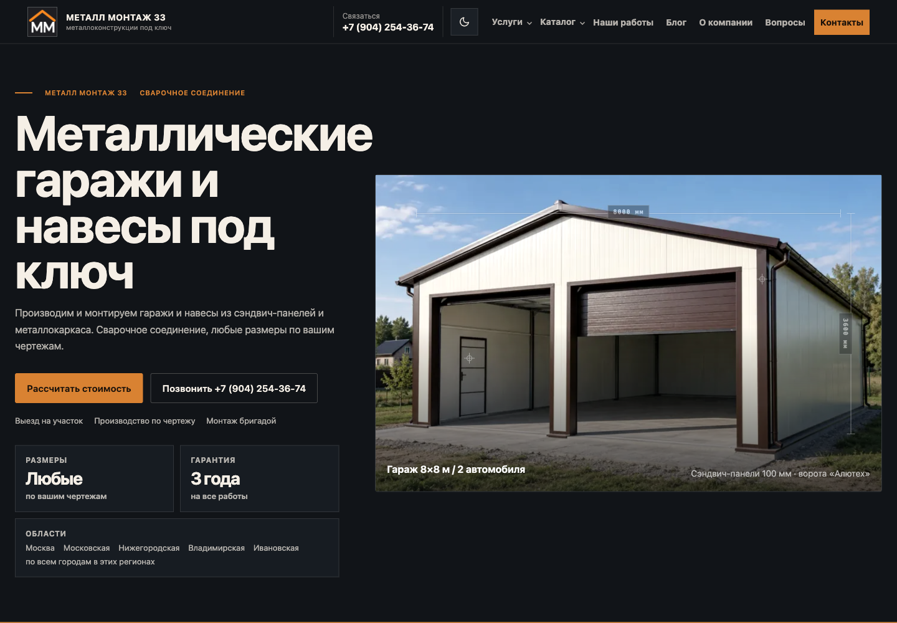
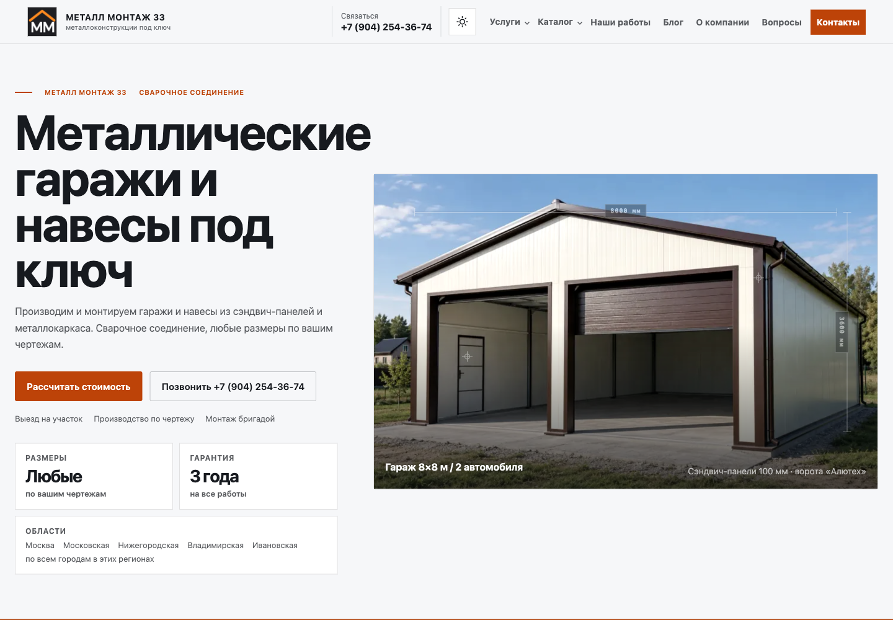
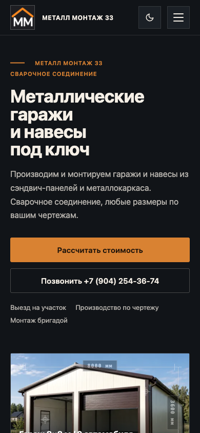
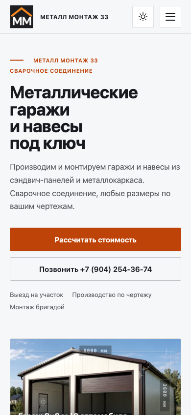

# Металл Монтаж 33 — скриншоты для портфолио

Съёмка: **16 октября 2026 года**. Сайт: [metallmontage33.ru](https://metallmontage33.ru/).

Скриншоты сделаны в Chromium из локальной production-сборки коммита `5f08d35b4e6a103b6bd98934eddd02d5b5be2d97`.

В наборе **96 PNG**: 19 страниц и экран 404 целиком в четырёх вариантах (компьютер / телефон × тёмная / светлая тема), 4 первых экрана главной и 12 интерактивных состояний.

- Компьютер: ширина 1440 px, окно 1440 × 1000 px.
- Телефон: ширина 390 px, окно 390 × 844 px.
- Полные страницы сохраняют естественную высоту; первые экраны, меню и просмотр фото сняты в размере окна, калькулятор — по границам секции.
- Перед съёмкой загружены изображения и шрифты; анимации отключены через настройку уменьшения движения.

## Первые экраны

| Компьютер — тёмная тема                                | Компьютер — светлая тема                                 |
| ------------------------------------------------------ | -------------------------------------------------------- |
|  |  |

| Телефон — тёмная тема                                                                       | Телефон — светлая тема                                                                        |
| ------------------------------------------------------------------------------------------- | --------------------------------------------------------------------------------------------- |
|  |  |

## Полные страницы

| Страница                                              | Компьютер: тёмная                                                     | Компьютер: светлая                                                     | Телефон: тёмная                                                      | Телефон: светлая                                                      |
| ----------------------------------------------------- | --------------------------------------------------------------------- | ---------------------------------------------------------------------- | -------------------------------------------------------------------- | --------------------------------------------------------------------- |
| Гаражи и навесы во Владимире под ключ                 | [PNG](desktop/dark/01-home.png)                                       | [PNG](desktop/light/01-home.png)                                       | [PNG](mobile/dark/01-home.png)                                       | [PNG](mobile/light/01-home.png)                                       |
| Каталог гаражей и навесов                             | [PNG](desktop/dark/02-catalog.png)                                    | [PNG](desktop/light/02-catalog.png)                                    | [PNG](mobile/dark/02-catalog.png)                                    | [PNG](mobile/light/02-catalog.png)                                    |
| Металлические гаражи во Владимире — каталог           | [PNG](desktop/dark/03-catalog--garazhi.png)                           | [PNG](desktop/light/03-catalog--garazhi.png)                           | [PNG](mobile/dark/03-catalog--garazhi.png)                           | [PNG](mobile/light/03-catalog--garazhi.png)                           |
| Навесы для автомобилей во Владимире — каталог         | [PNG](desktop/dark/04-catalog--navesy.png)                            | [PNG](desktop/light/04-catalog--navesy.png)                            | [PNG](mobile/dark/04-catalog--navesy.png)                            | [PNG](mobile/light/04-catalog--navesy.png)                            |
| Металлические гаражи под ключ во Владимире            | [PNG](desktop/dark/05-metallicheskie-garazhi.png)                     | [PNG](desktop/light/05-metallicheskie-garazhi.png)                     | [PNG](mobile/dark/05-metallicheskie-garazhi.png)                     | [PNG](mobile/light/05-metallicheskie-garazhi.png)                     |
| Гаражи из сэндвич-панелей во Владимире                | [PNG](desktop/dark/06-garazhi-iz-sendvich-panelej.png)                | [PNG](desktop/light/06-garazhi-iz-sendvich-panelej.png)                | [PNG](mobile/dark/06-garazhi-iz-sendvich-panelej.png)                | [PNG](mobile/light/06-garazhi-iz-sendvich-panelej.png)                |
| Гараж на две машины под ключ во Владимире             | [PNG](desktop/dark/07-garazhi-na-dve-mashiny.png)                     | [PNG](desktop/light/07-garazhi-na-dve-mashiny.png)                     | [PNG](mobile/dark/07-garazhi-na-dve-mashiny.png)                     | [PNG](mobile/light/07-garazhi-na-dve-mashiny.png)                     |
| Навесы для автомобилей под ключ во Владимире          | [PNG](desktop/dark/08-navesy-dlya-avtomobilej.png)                    | [PNG](desktop/light/08-navesy-dlya-avtomobilej.png)                    | [PNG](mobile/dark/08-navesy-dlya-avtomobilej.png)                    | [PNG](mobile/light/08-navesy-dlya-avtomobilej.png)                    |
| О компании Металл Монтаж 33                           | [PNG](desktop/dark/09-about.png)                                      | [PNG](desktop/light/09-about.png)                                      | [PNG](mobile/dark/09-about.png)                                      | [PNG](mobile/light/09-about.png)                                      |
| Блог о гаражах и навесах                              | [PNG](desktop/dark/10-blog.png)                                       | [PNG](desktop/light/10-blog.png)                                       | [PNG](mobile/dark/10-blog.png)                                       | [PNG](mobile/light/10-blog.png)                                       |
| Стоимость гаража под ключ: как сравнить сметы         | [PNG](desktop/dark/11-blog--stoimost-garazha-pod-klyuch-smeta.png)    | [PNG](desktop/light/11-blog--stoimost-garazha-pod-klyuch-smeta.png)    | [PNG](mobile/dark/11-blog--stoimost-garazha-pod-klyuch-smeta.png)    | [PNG](mobile/light/11-blog--stoimost-garazha-pod-klyuch-smeta.png)    |
| Конденсат в металлическом гараже: что проверить       | [PNG](desktop/dark/12-blog--kondensat-i-ventilyaciya-v-garazhe.png)   | [PNG](desktop/light/12-blog--kondensat-i-ventilyaciya-v-garazhe.png)   | [PNG](mobile/dark/12-blog--kondensat-i-ventilyaciya-v-garazhe.png)   | [PNG](mobile/light/12-blog--kondensat-i-ventilyaciya-v-garazhe.png)   |
| Кровля навеса: профнастил или поликарбонат            | [PNG](desktop/dark/13-blog--krovlya-navesa-dlya-avtomobilya.png)      | [PNG](desktop/light/13-blog--krovlya-navesa-dlya-avtomobilya.png)      | [PNG](mobile/dark/13-blog--krovlya-navesa-dlya-avtomobilya.png)      | [PNG](mobile/light/13-blog--krovlya-navesa-dlya-avtomobilya.png)      |
| Секционные или распашные ворота для гаража            | [PNG](desktop/dark/14-blog--sekcionnye-ili-raspashnye-vorota.png)     | [PNG](desktop/light/14-blog--sekcionnye-ili-raspashnye-vorota.png)     | [PNG](mobile/dark/14-blog--sekcionnye-ili-raspashnye-vorota.png)     | [PNG](mobile/light/14-blog--sekcionnye-ili-raspashnye-vorota.png)     |
| Размеры гаража на две машины: ширина, длина и ворота  | [PNG](desktop/dark/15-blog--razmery-garazha-na-dve-mashiny.png)       | [PNG](desktop/light/15-blog--razmery-garazha-na-dve-mashiny.png)       | [PNG](mobile/dark/15-blog--razmery-garazha-na-dve-mashiny.png)       | [PNG](mobile/light/15-blog--razmery-garazha-na-dve-mashiny.png)       |
| Основание под металлический гараж: подготовка участка | [PNG](desktop/dark/16-blog--osnovanie-pod-metallicheskij-garazh.png)  | [PNG](desktop/light/16-blog--osnovanie-pod-metallicheskij-garazh.png)  | [PNG](mobile/dark/16-blog--osnovanie-pod-metallicheskij-garazh.png)  | [PNG](mobile/light/16-blog--osnovanie-pod-metallicheskij-garazh.png)  |
| Навес или гараж: что выбрать для автомобиля           | [PNG](desktop/dark/17-blog--naves-ili-garazh-chto-vybrat.png)         | [PNG](desktop/light/17-blog--naves-ili-garazh-chto-vybrat.png)         | [PNG](mobile/dark/17-blog--naves-ili-garazh-chto-vybrat.png)         | [PNG](mobile/light/17-blog--naves-ili-garazh-chto-vybrat.png)         |
| Гараж из сэндвич-панелей: утепление и вентиляция      | [PNG](desktop/dark/18-blog--garazh-iz-sendvich-panelej-uteplenie.png) | [PNG](desktop/light/18-blog--garazh-iz-sendvich-panelej-uteplenie.png) | [PNG](mobile/dark/18-blog--garazh-iz-sendvich-panelej-uteplenie.png) | [PNG](mobile/light/18-blog--garazh-iz-sendvich-panelej-uteplenie.png) |
| Как выбрать металлический гараж под ключ              | [PNG](desktop/dark/19-blog--kak-vybrat-metallicheskij-garazh.png)     | [PNG](desktop/light/19-blog--kak-vybrat-metallicheskij-garazh.png)     | [PNG](mobile/dark/19-blog--kak-vybrat-metallicheskij-garazh.png)     | [PNG](mobile/light/19-blog--kak-vybrat-metallicheskij-garazh.png)     |
| 404 — страница не найдена                             | [PNG](desktop/dark/20-404.png)                                        | [PNG](desktop/light/20-404.png)                                        | [PNG](mobile/dark/20-404.png)                                        | [PNG](mobile/light/20-404.png)                                        |

## Интерактивные состояния

| Состояние                               | Компьютер: тёмная                            | Компьютер: светлая                            | Телефон: тёмная                             | Телефон: светлая                             |
| --------------------------------------- | -------------------------------------------- | --------------------------------------------- | ------------------------------------------- | -------------------------------------------- |
| Калькулятор гаража, 8 × 6 м, двое ворот | [PNG](desktop/dark/21-calculator-garage.png) | [PNG](desktop/light/21-calculator-garage.png) | [PNG](mobile/dark/21-calculator-garage.png) | [PNG](mobile/light/21-calculator-garage.png) |
| Калькулятор навеса, 8 × 6 м             | [PNG](desktop/dark/22-calculator-canopy.png) | [PNG](desktop/light/22-calculator-canopy.png) | [PNG](mobile/dark/22-calculator-canopy.png) | [PNG](mobile/light/22-calculator-canopy.png) |
| Просмотр фотографий                     | [PNG](desktop/dark/23-photo-lightbox.png)    | [PNG](desktop/light/23-photo-lightbox.png)    | —                                           | —                                            |
| Открытое меню со списком услуг          | —                                            | —                                             | [PNG](mobile/dark/23-mobile-menu.png)       | [PNG](mobile/light/23-mobile-menu.png)       |

[manifest.json](manifest.json) содержит размеры, маршруты и SHA-256 всех изображений.
